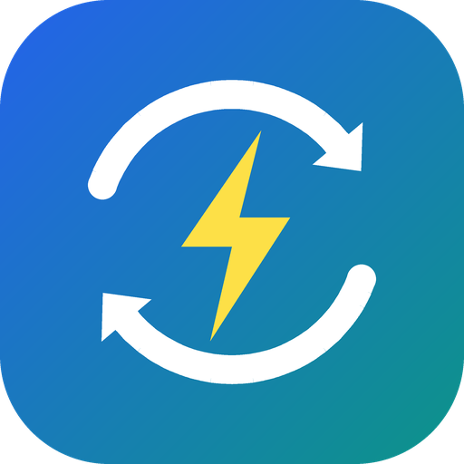

# WattSync

Charges an EV from solar. It reads an Enphase Envoy gateway, works out how much current the car can take, and tells an OCPP 1.6J wallbox what to do. A web dashboard shows live power and lets you pick a mode.

There are two interchangeable implementations that share one dashboard page. **Run only one of them at a time against the same wallbox.**

| | **ESP32-S3 board** (recommended) | **Raspberry Pi** |
|---|---|---|
| What it is | C++ firmware in [`esp32-poc/`](esp32-poc/), a board that costs a few dollars | A single Java 17 jar (Javalin) in this folder |
| Dashboard | `http://wattsync.local/` (port 80) | `http://<pi-address>:8080/` |
| Wallbox points at | `ws://wattsync.local:8080/pair` | `ws://<pi-address>:8080/pair` |
| Extras | Optional Tesla control (Bluetooth or your Tesla account), setup from a phone, updates over Wi-Fi | Same planner and API, no Tesla control |

**Contents:** [Quick start](#quick-start) · [Modes](#modes) · [Safety](#safety-and-recovery-behavior) · [Settings](#settings) · [Dashboard and HTTP API](#dashboard-and-http-api) · [OCPP](#ocpp) · [Documentation](#documentation) · [License](#license)

## Quick start

### What you need

- A solar installation with an **Enphase IQ Gateway (Envoy)** on your network, and its **local access token** (a long JWT; Enphase's token service at `entrez.enphaseenergy.com` issues it for your gateway, check Enphase's current instructions).
- An **EV charger that speaks OCPP 1.6J over WebSocket** and lets you enter a server address. The charger used while building this needs a remote start to begin a charge (see [OCPP](#ocpp)); other chargers are untested.
- For the ESP32 route: an **ESP32-S3 board with 16 MB flash and 8 MB octal PSRAM** (ESP32-S3-DevKitC N16R8), a USB-C **data** cable, and a **2.4 GHz** Wi-Fi network (the chip cannot join 5 GHz).
- For the Pi route: any Raspberry Pi that runs **Java 17**.
- On the computer you build from: **Git**, and **Python 3** (ESP32) or **Java 17 and Maven** (Pi). Nothing is installed system-wide for the ESP32 build; PlatformIO lives in a folder inside the project.

> **Safety first.** This software changes the charging current of real equipment. Read [Safety and recovery behavior](#safety-and-recovery-behavior) and the list of things not yet verified in `CLAUDE.md` before relying on it, try it with the car unplugged first, and keep the charger's own app or breaker within reach. It is provided without warranty (see [License](#license)).

### A. ESP32-S3 board: build, flash and run

1. **Get the code and the build tool.**

   ```bash
   git clone <repo-url> wattsync
   cd wattsync/esp32-poc
   python3 -m venv .venv
   .venv/bin/pip install platformio
   ```

2. **Create your settings file.** `src/secrets.h` is git-ignored, so a fresh clone does not have it: copy the template and edit it.

   ```bash
   cp src/secrets.example.h src/secrets.h
   open -e src/secrets.h        # or any editor
   ```

   Fill in `WIFI_SSID`, `WIFI_PASSWORD`, `ENPHASE_TOKEN`, optionally `ENVOY_IP` (leave empty to find the gateway as `envoy.local`), and a long random `OTA_PASSWORD` (it protects wireless updates). Never commit this file. These values are only defaults: anything you later save from the board's own setup page wins, so you can also flash the placeholders and enter everything from a phone.

3. **Flash by cable (the first time).** Plug the USB-C data cable into the board's **UART/COM** port, then:

   ```bash
   ls /dev/cu.*                                   # the board shows up as /dev/cu.usbmodem...
   .venv/bin/pio run -e esp32s3 -t upload
   .venv/bin/pio device monitor -e esp32s3        # Ctrl+C to leave
   ```

   If the upload cannot connect, hold **BOOT**, tap **RESET**, release **BOOT**, and run it again. If a newly built tool complains about the C++ headers on macOS, run the build as `env -u CPLUS_INCLUDE_PATH .venv/bin/pio run -e esp32s3 -t upload`.

   A healthy start prints the board name `wattsync`, `Wi-Fi: connected`, `Time: ...`, `mDNS: this board is wattsync.local` and `OCPP: listening on port 8080`.

4. **If it cannot join Wi-Fi, use the setup network.** With no Wi-Fi saved (or when the join fails for 3 minutes) the board opens its own network **`WattSync-Setup`** (password `wattsync`). Join it on a phone; the page opens by itself, or go to `http://192.168.4.1/setup`. Pick your Wi-Fi from the list and paste the Enphase token, the Envoy address and the update password. You can open it again any time by holding **BOOT** for 5 seconds. Details: [`docs/setup-network.md`](docs/setup-network.md). The setup password is the same on every board, so use the setup network at home only.

5. **Open the dashboard.** Browse to `http://wattsync.local/` (or the board's IP address, which the log prints). On the first visit, tap **Set your location** so sunrise and sunset, the daylight window and the forecast match where you live.

6. **Point the charger at the board.** In the charger's OCPP settings enter the server address `ws://wattsync.local:8080/pair` (or `ws://<board-ip>:8080/pair`). The charger adds its own id. It should appear on the dashboard within a minute. The board starts in **ECO** mode, so with solar surplus and a car plugged in it starts charging by itself.

7. **Update later over Wi-Fi (no cable).** After the first cable flash, with the board and the computer on the same network:

   ```bash
   env -u CPLUS_INCLUDE_PATH .venv/bin/pio run -e esp32s3-ota -t upload
   ```

   It takes about 30 seconds, uses `OTA_PASSWORD` from `src/secrets.h` without printing it, and keeps the last charging limit running while it restarts. If `wattsync.local` does not resolve, put the board's IP in `upload_port` in `platformio.ini`.

More on the ESP32 route (console commands, what to check on a real charger, troubleshooting): [`esp32-poc/README.md`](esp32-poc/README.md).

### B. Raspberry Pi: build and run

1. **Build the jar** (Java 17 and Maven; the tests run as part of the build):

   ```bash
   git clone <repo-url> wattsync
   cd wattsync
   mvn clean package            # add -o to build offline if your Maven mirror is unreachable
   ```

   This produces `target/solar-charger-1.0-SNAPSHOT.jar` with all dependencies included.

2. **Run it** with your Enphase token (the app refuses to start without it). On a US supply set 240 V:

   ```bash
   ENPHASE_TOKEN=<your-token> HOUSEHOLD_VOLTAGE=240 java -jar target/solar-charger-1.0-SNAPSHOT.jar
   ```

   The dashboard and the OCPP endpoint are both on port **8080**. Open `http://<pi-address>:8080/`, tap **Set your location**, and point the charger at `ws://<pi-address>:8080/pair`.

3. **Keep it running as a service** (recommended). Copy the jar to the Pi, put the settings in `/etc/solar-charger.env` (one `NAME=value` per line, see [Settings](#settings)), and run the jar from a systemd unit that uses that file as its `EnvironmentFile`. Restart it with `sudo systemctl restart solar-charger` and read the log with `journalctl -u solar-charger -f`. A clean stop saves the history first. The step-by-step deploy guide, with the unit file, is [`docs/deploy-to-raspberry-pi.pdf`](docs/deploy-to-raspberry-pi.pdf).

### Run the tests

No board, charger or car is needed for any of these.

```bash
mvn -o test                                                                            # Java: planner, daylight, history, OCPP, API
cd esp32-poc && CPLUS_INCLUDE_PATH=$(xcrun --show-sdk-path)/usr/include/c++/v1 \
  .venv/bin/pio test -e native                                                         # C++ core on your computer (macOS path shown)
node --test tests/dashboard/dashboard.test.mjs                                         # the dashboard page (Node 18 or newer)
```

### Optional: control a Tesla directly (ESP32 only)

Besides controlling the charger, the board can control a Tesla itself, either over **Bluetooth** or through the owner's **Tesla account** (the Fleet API, which needs a Tesla developer app of your own and is billed per request by Tesla). It is off by default and **untested on a real car for the account route**. Read [`docs/tesla-car-control.md`](docs/tesla-car-control.md) and [`docs/tesla-fleet-api.md`](docs/tesla-fleet-api.md) first. Tesla mode and charger mode are separate setups: with Tesla mode on, the board does not talk to a wallbox at all.

### If something does not work

- **Dashboard does not load:** check the boot log for `Dashboard: http://wattsync.local/`, try the IP address, and make sure your computer is on the same network.
- **Board cannot join Wi-Fi:** it must be a 2.4 GHz network; after 3 minutes the setup network opens so you can fix the details.
- **`envoy.local` not found:** enter the gateway's IP address on the setup page (or in `ENVOY_IP`).
- **Boot lines but nothing from the program:** you are probably on the board's other USB port; use the UART/COM port with the default build.
- **Charger connects, then drops, or never starts a charge:** see [OCPP](#ocpp); this charger family needs a remote start, and the log shows each command sent.
- More: the Troubleshooting section of [`esp32-poc/README.md`](esp32-poc/README.md).

## Modes

| Mode | What it does |
|---|---|
| **ECO** | The solar left over after the house, plus the grid allowance, from the charger's 6 A minimum upwards. The only mode that looks at the house's own load. |
| **MAX_SOLAR** (shown as **Max solar**; it used to be called BALANCED, and that name still works) | The car charges at the speed the panels are producing, no matter what the house is using; any power the house needs beyond the panels comes from the grid. The allowance only tops the car up to the next whole amp or to the 6 A minimum. |
| **FAST** | A fixed current you choose (6 to 40 A, default 32). The meters are still read once a minute, but only to show live power on the dashboard; they never change the current. Not affected by the daylight window. |

**The rule for ECO: stay within the grid allowance, with one deliberate exception for short dips.** Max solar deliberately ignores the house: grid import is whatever the house plus the car use beyond the sun. FAST (shown as Custom on the dashboard) ignores the allowance entirely. Both solar modes charge only while the available current covers their minimum. When it falls short, the charge drops to the minimum current and keeps going for up to **5 minutes**, then stops. During those minutes the car can draw its minimum (6 A in ECO, 10 A in BALANCED) from the grid, a little over the allowance; a shortfall that ends sooner never stops the charge.

### How ECO and Max solar decide

Every poll (60 s) the controller works out the available current:

`available = charger draw + (export + grid allowance) / voltage`

Using the charger's own draw avoids a feedback loop: the car's load shrinks the exported surplus, so surplus alone would make the limit oscillate. The allowance (default 1 kW, a slider on the dashboard from 0 to 1 kW) is the most grid power ECO will use.

**Max solar does not look at the house.** Its input is the solar output alone, in amps. The car runs at the next whole amp (or at 6 A if the sun is below that) when the grid top-up needed fits inside the allowance, and at the amp below when it does not. For example, at 240 V with a 600 W allowance: 1 kW of sun is 4.2 A, 6 A needs about 440 W more, which fits, so it charges at 6 A; 2 kW of sun is 8.3 A and 9 A needs about 160 W, so it runs 9 A; 0.5 kW of sun cannot reach 6 A with 600 W, so it stays off. Only ECO subtracts the house load.

The value is smoothed with two moving averages, a slow one (180 s) for increases and a fast one (60 s) for decreases, and the smaller of the two is used. So it backs off quickly when importing and ramps up cautiously. Because the meters are read once a minute and smoothed, import can briefly exceed the allowance for a poll or two after a sudden drop before the stop is issued.

| Rule | ECO | Max solar |
|---|---|---|
| Input | solar minus house, plus the allowance | the solar output; the allowance tops up to a whole amp |
| Minimum current | 6 A | 6 A |
| Start | smoothed available at least 7 A for 3 min | at least 6 A (after the top-up) for 3 min |
| Stop | after smoothed available has stayed under the minimum for 5 min (the charge runs at the minimum meanwhile; the 5 minutes start over if the sun returns first) | same |
| Minimum off time | 2 min | 2 min |
| Limit changes | up by at least 2 A, down by 1 A or more; increases 60 s apart, decreases 30 s apart | same |

The log shows `stop: surplus below the minimum, would import more than the allowance` when this happens.

Above the minimum current, what keeps grid import near the allowance is stepping the limit down. That reacts to a 1 A shortfall (about 240 W), while stepping up waits for a 2 A gap, so a gust of cloud is followed down quickly and a brief sunny spell is not chased upwards. Because the charger takes whole amps, import can still sit up to about one amp (roughly 240 W) over the allowance until the next step, and for up to a poll or two after a sudden load while the smoothing catches up. Changing the allowance re-seeds the averages so it takes effect on the next reading.

A charge that is already running (after a restart, or switching from FAST) is adopted at once and can be adjusted or stopped without waiting.

## Safety and recovery behavior

- **Gateway outage.** If the Envoy gives no data for 150 s, ECO and Max solar stop (the grid import is unknown) until it returns. Errors are logged once, then at most once a minute. An expired token is reported specifically.
- **Daylight window.** ECO and Max solar run only from 30 minutes after sunrise to 1 h before sunset (both margins adjustable, 0 to 180 minutes, under the gear icon (*Settings*); saved across restarts. The south-east facing array makes good power early in the day), calculated offline (NOAA formula) for the configured location. Outside it: no polling, no meter requests, a running charge is stopped once. Because nothing is measured then, the power picture shows **–** and *Not read at night* for Home and Grid (Solar says *Resting until sunrise*) instead of an old number, and the line under the Today graph says when the last reading was. Can be switched off on the dashboard. FAST is unaffected.
- **Saved state.** Mode, Custom current, grid allowance, the daylight toggle, and each charger's last status, transaction and limit are saved to a JSON file (only when they change, to spare the SD card, and on shutdown). After a restart or a dropped connection the charger shows as "restored, verifying" and is asked for its real status. Saved charger state older than 1 h is ignored. A missing or corrupt file means defaults.
- **Real charger current.** Every poll the controller asks a charging wallbox for its meter values. The log and dashboard say whether the draw is `measured` or `assumed from limit`. A charger that refuses is not asked again.
- **Departure goal ("Ready by").** Under *Settings > Ready by* turn on the switch and ask for "at least X kWh by a time" (for example 20 kWh by 7:00 am, or 5:30 pm; any time of day). While there is time to spare nothing changes and the sun charges as usual. When the time left is only just enough (plus a 15 minute margin), the goal takes over and charges at the lowest speed that still gets there, using the grid if it must, even outside solar hours. It needs a car plugged in, is ignored while paused and in Custom mode, never goes above the maximum current, and counts energy delivered in the 16 hours before the deadline. The headline shows progress ("Goal: 12 of 20 kWh by 7:00 am").
- **Cheapest hours (for time-of-use power plans, no solar needed).** A fourth mode. It charges at the maximum current whenever power is not expensive and stops during the expensive hours. The expensive hours are the peak window under *Settings > Money > Higher price at certain hours* (default 4 pm to 9 pm), with an *Also on weekends* switch (on: every day, off: Monday to Friday only). That matches the main California plans: PG&E E-TOU-C and SCE TOU-D-4-9PM both have a 4 to 9 pm peak every day; some plans (PG&E E-TOU-D) are weekdays only. The hours are the same in summer and winter on those plans (summer is June to September), only the prices change, so there is one window, not seasonal tabs. It never reads the solar meter for charging (a lost meter is not a fail-safe, and with no meter set up the board shows price tiles, *Price now*, *Cheap at* / *Peak at* and *Car*, instead of the power picture). A *Ready by* goal still wins when time runs short. Telemetry: `peakWeekends`, `controller.expensiveNow`, `controller.secondsToPriceChange`. Under *Money > Higher price at certain hours* a **Your plan** list fills in the hours for PG&E E-TOU-C and SCE TOU-D-4-9PM (hours only, as published in October 2026; the prices change, so enter yours). Not built yet: separate winter and summer prices.
- **Maximum current.** One setting (6 to 40 A, default 40) caps every mode, including Custom. Set it to what your wiring and breaker can carry.
- **Peak price.** Under *Settings > Money*, the switch *Higher price at certain hours* adds an optional second price with its hours (24 h clock) so money saved counts the sun at the price of the hour it was used. Days recorded before it was set keep an estimate.
- **Messages.** Optionally paste a webhook address (Slack, Discord, Home Assistant, IFTTT, Zapier ...) under *Settings*. WattSync posts `{"text": ..., "content": ...}` when charging ends, the solar meter is lost or returns, the charger disconnects, saved settings are found damaged, or the goal takes over. The same message is sent at most once per 10 minutes. The address is stored on the controller and the dashboard only shows its host. Use the *Send test* button to check it.
- **Damaged settings.** If the state file cannot be read (and its `.bak` copy cannot either), the app starts **paused** and says so in the activity log, rather than charging on defaults. The previous good copy is kept as `solar-charger-state.json.bak`.
- **Cross-site protection.** Every change (`POST`) must carry the header `X-WattSync: 1`. The dashboard adds it; a web page on another site cannot. With curl add `-H 'X-WattSync: 1'`.
- **Charger connection.** Heartbeat interval 60 s, idle timeout 5 min.

## Settings

Environment variables (set in `/etc/solar-charger.env` under systemd):

| Variable | Default | Meaning |
|---|---|---|
| `ENPHASE_TOKEN` | required | Enphase access token (JWT). The app refuses to start without it. |
| `HOUSEHOLD_VOLTAGE` | 230 | Volts used to convert watts to amps. Use 240 on a US supply. |
| `SITE_LATITUDE` / `SITE_LONGITUDE` | 37.8412 / -121.2691 | Location for sunrise and sunset (Lathrop, CA). Used only until a location is saved from the dashboard (*Settings > Solar hours > Location*), which wins. |
| `SITE_TIMEZONE` | America/Los_Angeles | Timezone for the daylight window, the history days and Cheapest hours. Same rule: a location saved from the dashboard wins. |
| `STATE_FILE` | `solar-charger-state.json` | Where state is saved (relative to the working directory). |
| `HISTORY_FILE` | `solar-charger-history.tsv` | Where the history is saved: this file holds the last two days by the minute, the activity log and the daily totals (fully rewritten every 30 minutes if changed, and on a normal stop); a second file next to it with `.long` added holds the 5-minute and hourly records and only ever grows at the end, and a third with `.journal` added is rewritten every minute with just what is new since the last full save and folded back in at the next start. A crash or power cut loses at most a minute. |

Tunable constants live in [AppConfig.java](src/main/java/com/example/config/AppConfig.java): poll interval, amp limits, smoothing time constants, deadband, start and stop timers, allowance default and maximum, daylight margins, fail-safe delay, state refresh and age limits. Change them and rebuild.

Dashboard-controlled, saved across restarts: mode, Custom current, grid allowance (0 to 1000 W), daylight window on/off.

## Dashboard and HTTP API

| Endpoint | Purpose |
|---|---|
| `GET /` | Dashboard |
| `GET /api/telemetry` | All live values as JSON: power, charger, controller state, daylight window |
| `POST /api/mode?mode=ECO\|MAX_SOLAR\|FAST\|CHEAPEST[&amps=6-40]` | Change mode, optionally the Custom current. `CHEAPEST` is "Cheapest hours" (`cheap` also works). The old name BALANCED and the spelling maxsolar are still accepted. Answers 400 with a message and changes nothing if the mode is unknown or the current is not a whole number from 6 to 40. |
| `POST /api/allowance?watts=0-1000` | Set the grid allowance (ECO and Max solar) |
| `GET /api/history[?daysAgo=0-364]` | A day's power in 5-minute steps (hourly once a day is more than 30 days old), `[time, solar, home, grid, car, mode, flags]`, that day's energy totals and the daylight window |
| `GET /api/days?n=1-365` | Daily energy totals for the last n days, `[day, solar, car, car from sun, import, export, saved, goal]` (kWh; `saved` in dollars; `goal` is 0 if no Ready by goal was judged that day, 1 reached, 2 missed) |
| `GET /api/events?n=1-20&offset=0-1000` | One page of the activity log, newest first (default 5), with the total. Only the last 24 hours are kept and shown, and a run of limit changes less than an hour apart is one line (*Changed limit 4 times, now 13 A: more solar*). The dashboard asks only for the page on screen. |
| `GET /api/sessions?n=1-100&offset=0-1000` | One page of the charging sessions (newest first), the total, plus the one in progress: start, end, kWh, share from the sun, average amps, money saved, the mode it ran in (`mode`, with `modeMixed` if the mode changed during it), `plugged` (when the car was plugged in before it started, 0 if not seen), `tag` (a short one-way fingerprint of the ID tag the charger sent when the charge started, never the tag itself; empty if none) and why it ended. Taken from the wallbox's start/stop messages and meter. |
| `GET /api/diagnostics` | How the device is doing: uptime, why it last started, memory. The board adds restart and crash counts, the last crash with its time, Wi-Fi signal and the firmware build time. |
| `GET /api/export.csv` | Every day's energy totals as a spreadsheet file (a simple backup of the long-term numbers) |
| `POST /api/maxamps?amps=6-40` | The most current any mode may ask for (Custom is lowered if it was higher) |
| `POST /api/goal?kwh=0-100[&byMinutes=0-1439]` | The departure goal: kWh wanted (0 = off) and the time of day as minutes after midnight; telemetry shows `goal` with progress |
| `POST /api/notify?url=` | The web address messages are posted to (empty turns them off); `POST /api/notify/test` sends a test. Telemetry shows only the host (`notifyTo`). |
| _telemetry_ `meterLinked` | false when no solar meter has been set up (the dashboard then says "No solar meter paired" and greys out Eco and Max solar); `enphaseOk` says whether it can be read. |
| `POST /api/site` (`lat`, `lon`, `tz`, `name`, sent in the request body) | Saves where the panels are: latitude and longitude (kept to two decimals), the IANA time zone and the town's name. The ESP32 board restarts to use it (its clock, daylight window and history days start from it; it knows the US and Canadian zones so far, others get 400); the Pi keeps it in its state file and asks for a restart of the app. Telemetry `site` gives `lat`/`lon` rounded to 0.1 degree, `set`, `timezone` and `name`. |
| `POST /api/car/mode?enabled=true\|false&confirm=yes` (Tesla mode, off by default), `GET /api/car/hotspot`, `POST /api/clock?epoch=`, `POST /api/car/pair` (VIN in the body), `/api/car/refresh`, `/api/car/watch?enabled=`, `/api/car/test?action=start\|stop\|amps[&amps=]`, `/api/car/through?mode=charger\|car[&confirm=yes]`, `/api/car/policy?onReturn=keep\|tell\|stop`, `/api/car/wake`, `/api/car/allowwake?enabled=`, `/api/car/cancel`, `/api/car/forget` | Tesla car link over Bluetooth. **ESP32 board only**: on the Pi these answer 400 "Car control needs the ESP32 board." and telemetry shows `car: {supported: false}`. |
| `POST /api/rate?cents=0-200[&peakCents=0-200&peakStart=0-23&peakEnd=1-24&peakWeekends=true\|false]` | Also sets the peak price and its hours, and whether they apply on weekends (these hours are the expensive hours of Cheapest hours) |
| `POST /api/pause?enabled=true\|false` | The kill switch: stop charging whatever the mode (`true`), or hand the charger back to the saved mode (`false`). Saved, so it survives a restart or crash. |
| `POST /api/daylight?enabled=true\|false&startMin=0-180&endMin=0-180` | Turn the daylight window on or off, and/or set how many minutes after sunrise it opens and before sunset it closes (each parameter optional; nothing changes if any value is invalid) |

All `POST` calls need the header `X-WattSync: 1`, for example `curl -X POST -H 'X-WattSync: 1' 'http://wattsyncpi.local:8080/api/mode?mode=ECO'`. There is no password on the dashboard or API. Keep it on your home network.

### Dashboard behavior

- **Feedback on every action.** A short toast confirms each change ("Eco on", "Allowance 800 W"), with a second line only when there is something to say (such as "Saved, charger offline"), and errors show the reason in red. The Custom slider and the allowance slider (0 to 1000 W, steps of 100) both send 5 s after you stop moving, with a countdown under them (*Changing to 500 W in 4 s…*); each new move restarts the wait. Out-of-range values are refused by the server.
- **Custom current slider.** Moving the slider does not send anything right away. The dashboard counts down ("Sending 20 A in 3 s…") and sends one command once the slider has been still for 5 seconds, so dragging through many values never floods the charger. Each new move restarts the wait. Switching to another mode drops an unsent change. The delay is `CUSTOM_DEBOUNCE_MS` in `dashboard.html`.
- **Pause charging** (the button at the top of the mode card) is a kill switch that beats every mode, Custom included. It stops a running charge at once and keeps a stop in force: no start, no limit change, even if the car is started from the wallbox's own app. The mode is left untouched, and **Resume charging** simply hands the charger back to it. The pause is saved with the other settings, so a restart or crash does not lift it; after a restart the app stays paused until you resume. Mode and current changes made while paused are kept and take effect on resume. The meters are still read, so the dashboard stays live.
- **Mode changes** show the new mode at once and are put back if the controller refuses or cannot be reached.
- **Connection.** The pill at the top shows Live or Offline. After two failed refreshes (about 5 s) a banner says the controller cannot be reached, and a toast confirms when it is back.
- **Layout.** Built phone-first and made of tiles, so the important things fit on one screen without scrolling: a headline with the Pause button, the power flow as four tiles joined by arrows through a supply node (on a phone it runs top to bottom, sources then supply then loads, so every arrow is straight; on a wider screen it runs left to right with the lines converging on a round supply node), today's three numbers, and the mode buttons. Below them come today's graph, the activity feed and the charging sessions. A gear icon next to the Live pill opens *Settings* (solar hours, the start and stop minutes, and the price). On a wide screen the headline, flow and numbers sit on the left and the modes and activity on the right, ending level; below them the graph (which grows to match) sits beside the charging sessions, so everything ends on the same line with no gaps. Tap targets are at least 44 px and nothing scrolls sideways (the page is also locked against sideways panning, respects the iPhone's side notch areas, and its typed boxes use 16 px text so iOS does not zoom the page in when you tap one).
- **Elapsed time** is short enough for a phone: *just now*, *30s ago*, *45m ago*, then from an hour on whole hours with a "~" (*~5h ago*: up to half an hour past the hour rounds down, more than that rounds up), then *~2d ago*. It appears under Solar when the reading is stale and in *Meter updated*. At night, when the app deliberately stops reading the meter, both say *Resting until sunrise* instead of an age; an age shows only when the daytime reading is really stale.
- **What the charging gave you.** Under the power picture, one card shows the energy (or estimated miles of range) the car took and the money saved, with a bar for the share that came from your solar. Its tabs (**Today**, **Week**, **Month**, **Year**) also drive the graph, which sits in the same card: on a phone it is folded away behind **Show graph** (it opens in place and stays open next time), and on a wide screen it is always shown. A one-tap button flips the unit and is labelled with what it switches to (**Show miles** or **Show kWh**). Saved is the sun's share of the car's energy times your price; a day with no recorded saving is estimated at the normal price. On a wide screen the headline runs across the top and this card sits on the left, level with the power flow and the modes on the right, so the savings and the graph are on screen without scrolling (activity and sessions are underneath); there the comparison with gas is a tab beside the graph (**Graph** / **Compared with gas**) instead of opening in place. Under the solar bar, a green line says how the charging compares with gas (for example **~$113 less than gas.**); tapping it opens three bars (what the same miles would have cost in a gas car, on a grid-only electric car, and what you paid) and two chips (the saving from driving electric and the saving from charging with solar). The gas price and the gas car's miles per gallon are set in *Settings > Display*, next to *Miles per kWh* (which is now always shown, because the comparison needs it); they start at $4.60 and 28 mpg as a guess, stay in the phone's browser, and every figure is an estimate marked with `~`. When a charge finishes, a short green card appears under the headline with what was added, the solar share and the saving.
- **Location (onboarding).** Until the owner saves one, a built-in default (Lathrop, CA) is used and a **Set your location** button shows under the headline. *Settings > Solar hours > Location*: type a zip code or a town, **Find**, pick the match, **Use this place**. The *phone* looks it up on open-meteo.com's geocoding service (it sends what was typed and the phone's address) and sends the controller only the coordinates, the time zone and the town's name (in the request body); the zip code is never kept. Saving restarts the board (about a minute) so its clock, solar hours and history days start from the new place; the forecast waits until a location is saved. Non-US places work on the Pi; the board knows the US and Canadian time zones so far.
- **Today and Tomorrow bubbles** (a row of small buttons across the bottom of the headline card, next to the Solar Score, for homes with a solar meter and a set location: a weather picture (sun, partly cloudy, cloud, rain, from the day's cloud cover and rain) and the expected solar, such as **Today ~93 mi ›** and **Tomorrow ~30 mi ›**, in kWh or as ~miles of range depending on the unit chosen in Settings. Today is the whole-day estimate, never below what is already made; after the solar hours it says what was made (**Today ~78 mi made ›**), because the meter is not read then. Either opens a card with an hourly sunshine chart for tomorrow, the best hours, a rough kWh figure and a line about the current mode). The **phone** asks open-meteo.com for the forecast (never the board or the Pi), at most every 3 hours, sending only the area to a tenth of a degree (about 11 km; telemetry `site.lat`/`site.lon` give it that way) and its own address, and keeps the last answer on the phone. The kWh figure is learned from your own solar over the last 7 days compared with those days' weather (needs 3 usable days; otherwise only the words). Text only: it changes nothing about charging. *Settings > Display > Show tomorrow's forecast* turns it off and nothing is requested. Weather data by Open-Meteo.com (CC BY 4.0); the free service is for non-commercial use.
- **Your impact** (on a phone, a small button under the headline such as **Solar Score 74 ›** with a small ring and the grade letter beside it opens it as a sheet with a **Done** button (a centred card on a wide screen, in two columns); Week / Month tabs; worked out on the phone from `/api/days` and `/api/sessions`, so it adds no work for the board or the Pi). The score is a **wheel**: a ring filled to the score out of 100 in the same gold-to-green as the *From your solar* bar, with the grade letter in the middle and "81 of 100" under it (the letter takes the colour the gradient has reached; a small version of the ring sits on the button under the headline; it fills in when the card opens if the phone allows animation). Grades: A 90 or more, B 75, C 60, D below: with solar it is 50 points for the share of the car's energy that came from solar plus 30 for charging outside the expensive hours, scaled to 100; without solar (no meter, or no solar energy in the period) it is called **Charge Score** and counts only the off-peak share. A part that does not apply (no peak price and not in Cheapest hours) is dropped and the rest share the 100. Ready by goals count for 20 points when at least one deadline was judged in the period (the controllers now record, once per deadline, whether the goal was reached: a line in the activity log, "Departure goal met" or "missed", and a per-day result kept for 400 days; a day with no car plugged in and no energy is not judged), with a **Ready on time** badge for days in a row. **Saved by Cheapest hours** compares each Cheapest-hours charge with charging at full current from the moment the car was plugged in (an estimate; needs a peak price above the normal price and a known plug-in time). Under it: miles, how much cheaper than gas, CO2 avoided against gas (solar homes only; 8.9 kg a gallon and a rough 0.23 kg per kWh for the grid), a streak (sunny days: at least half the car's energy from solar, skipping days with no charge or too little sun to cover it; or peak-free days for homes without solar), badges, and **Share image**, which draws a picture on the phone and opens the share sheet. The off-peak share assumes each charge drew evenly from start to stop. Everything is an estimate.
- **Motion.** The power picture is alive: dots travel along each line in the direction the power flows (faster with more power; a dashed grey line means no flow), the Solar, Home, Grid and Car numbers glide to new values, the supply bar glows softly while anything is flowing, and the Car tile shows a light sweep while charging. The headline slides to new wording, the icon pops with a ring when charging starts, breathes while charging, shows a blue arc circling it while it is waiting with no countdown, and a ring that drains with the countdown when there is one. The mode highlight slides between Eco, Max solar, Custom and Cheapest hours (a 2 by 2 grid); the two sliders show a bar that fills during the 5-second wait and a check mark when sent; new Activity and Charging sessions rows slide in; the Settings sheet and help cards fade in. All of it stops with Reduce Motion on, and the dots pause while the page is hidden.
- **Pull down to refresh.** In the Home Screen app (iOS gives a web app no pull-to-refresh of its own), pulling the page down from the top brings the WattSync logo into view in a small round badge: it slides down and grows as you pull while its two sync arrows turn, the yellow bolt pops and glows once you have pulled far enough, and after you let go the arrows spin around the bolt while the page reloads. There is no text, and with Reduce Motion on nothing spins or pops. A reload also picks up a newer version of the page after an update. It is off in a normal Safari tab, which already has it, ignores pulls that start on a slider or while a card is open, and can be tried elsewhere by adding `?pull` to the address. The page also declares itself as a web app (`apple-mobile-web-app-capable`) and is served with `no-cache`.
- **Plain-words help.** A small blue **i** next to anything that may be unclear (the charging modes, the current, the grid allowance, the power picture, Saved today, From the sun, solar hours, the price, power for the car, the fail-safe) opens a short explanation with a *Got it* button (Esc or a tap outside also closes it). The texts are the `TIPS` list in `dashboard.html`.
- **Diagnostics.** Under *Settings* (the gear), *Diagnostics* opens a short list: how long it has been running, why it last restarted, and on the board how many restarts it has counted (and how many were crashes, watchdogs or brownouts), the last crash and when, free memory, Wi-Fi signal and when the firmware was built. The board keeps the counters in flash, so a normal restart cannot hide a crash from the night before. The list is fetched only when opened.
- **Charging sessions.** A tile lists each charge (*Charging now since 10:01 am*, *Yesterday 9:42 am to 3:05 pm*) with its kWh, the share that came from the sun and why it ended in plain words (*stopped from the app*, *car unplugged*, *stopped at the charger*, *charger restarted*, ...). Kept for the last 30 days (and at most 400 sessions) and saved with the history; the graphs and daily totals are separate and keep their own, longer history. Five show at a time, with *‹ Newer* / *Older ›* buttons; only the page on screen is requested.
- **Headline.** One sentence saying what is happening, for example *Charging at 10 A* with *Using 2.40 kW: 2.03 kW from the sun, 372 W from the grid* under it, or *Charging is paused*, *No car plugged in*. When Eco or Max solar is only waiting, the title says why and the line under it gives the numbers and a countdown: *Waiting: home is using the solar* (*Home is using 4.9 kW of your 5.0 kW solar. Needs 0.7 kW spare to start.*), *Waiting for more solar*, *Starting soon* (*Starts in about 2 min if it holds.*), *Waiting to restart*, *Waiting for sunrise*, and, while a charge rides out a dip, *Low solar, charging at 6 A* (*Stops in about 3 min if it stays low.*). It is coloured green when charging, blue when waiting, amber when paused, offline or in a dip, and red on a fault. The countdowns come from `controller.waitSeconds` in `/api/telemetry` (seconds until a start or stop can happen, -1 when no timer runs); the wording is `waitView` in `dashboard.html`.
- **History tabs.** The card's four tabs are **Today** (the curve), **Week**, **Month** and **Year**. The last three show one stacked bar per day (per month for the year): the part of the car's energy that came from the sun (yellow) and from the grid (red), with a legend that reads *Charging the car used: ☀️ Sun · 🔌 Grid* and a line above saying how much charged the car, what share came from the sun and what you saved. Tap a day's bar to see that day's curve (use the chip at the top right of the card to go back). With a mouse, hovering a bar highlights it and shows that day's numbers under the graph (for example *Sat 31 Oct: 29.6 kWh (sun 21.5 kWh, grid 8.1 kWh) · saved $5.20*, or in miles); a phone has no hover, so it keeps the tap. Daily totals are kept for a year, and the curves of older days stay available at lower detail.
- **Today's graph.** Solar (yellow, with a pale fill), car (blue), home without the car (violet) and the grid by the hour: import stands up from the zero line in red, export hangs down from it in green (the space below zero only appears on days that have some export). The daylight window is shaded, and a strip underneath shows when the car charged (blue) or charging was paused (grey). The graph starts at the day's first sign of life (at least 50 W of solar, the car drawing power, or a charge running; usually the start of the solar hours), not at a fixed hour, and ends where the solar hours end (or just past a later reading). Quiet readings before that, such as an overnight Custom or Paused stretch of home use only, are left off; a night charge starts the graph. A block above it always shows the day's solar, car, imported and exported energy, and a row of labelled columns below it shows the latest reading (*Now*, Solar, Home, Car, Grid in or out) until you hover with a mouse or tap with a finger; a tap keeps its reading until the next tap. On a phone the graph box is 250 px tall. Touch or hover on it to read the exact values for that moment. It is drawn at the screen's own width, so it stays readable on a phone.
- **Activity.** The latest things that happened and why, for example *Started charging at 7 A: enough solar*, *Lowered charging to 9 A: less solar left*, *Stopped charging: home is using the solar*, *Car plugged in*, *Charging paused by you*, *Solar hours began*, *Lost contact with the solar meter: charging stopped*. Five events show at a time; when there are more, *‹ Newer* and *Older ›* buttons with a page count (*1 of 6*) step through the whole log; each press asks the controller for just that page, so a long history costs nothing extra. Events from an earlier day show the day under the time.
- **Typed settings.** The electricity price shows a green check mark next to it as soon as you change it. Press it (or Enter) to save; Escape puts the saved value back. Sliders save on their own: the allowance when you let go, the Custom current a few seconds after you stop moving.
- **User guide and demo.** [docs/user-guide.pdf](docs/user-guide.pdf) explains the dashboard to the car owner in plain words, and [docs/demo/wattsync-demo.mp4](docs/demo/wattsync-demo.mp4) (also a [GIF](docs/demo/wattsync-demo.gif)) is a short captioned walkthrough. Both mark the screens with numbered callouts and explain each feature. Both use made-up sample numbers.
- **Miles instead of kWh.** *Settings > Display* switches the energy shown on the dashboard from kWh to estimated miles (kWh times *Miles per kWh*, default 3, shown with a `~`). It covers the car's energy today and from the sun, the day bars and their total, each charging session, the charge rate (kW becomes mi/h; the Car tile shows the other unit under its big number, so kW sits under miles per hour and miles per hour under kW, not the amps, which the headline already gives; a charger that does not report its real draw shows the set limit, marked with a `~`) and the goal (typed in miles; a hint shows the whole kWh that is actually sent). It is display only and kept in the phone's browser: the API, the planner, savings (dollars), the CSV export and message text stay in kWh. Activity lines written by the controller still say kWh. Kilometres are not offered yet.
- **Savings.** *Saved today* is the sun's share of the car's energy today valued at your electricity price (a setting, in cents per kWh, default 30). *From the sun* is that share as a percentage. The energy is added up from the once-a-minute readings, so it is an estimate, typically within a few percent; the sun's share is whatever solar was left after the house, up to what the car drew.
- **Live pill and meter age.** The pill at the top says *Live*. In the daytime, if the solar meter has gone quiet, it turns amber and says how old the reading is (*Meter 12m old*, *Meter ~5h old*). The same age shows under Solar. The reason charging is or isn't happening is the headline itself (*Waiting for sunrise*, *Waiting: home is using the solar*, *Lost contact with the solar meter...*), written in `waitView`, `fmtReason` and `whyText` in `dashboard.html`.
- **Branding.** The page is called WattSync: the logo (a lightning bolt inside sync arrows) is inline in the header and also used for the browser-tab icon, embedded in the page so nothing extra is fetched. The logo files are in `docs/logo/` (`wattsync-logo.svg`, and a 512 px `wattsync-logo.png`). The first card is titled *Live power*.
- **Custom mode** still shows live solar, grid and home power. The meter reading is for display only; a gateway problem is shown but is never a fail-safe, since Custom needs no data.

## OCPP

Enter `ws://<host>:8080/pair` in the wallbox (it adds its own charger id, so `/pair/<chargerId>` is what actually arrives; the id may also be given as `?chargerId=`; default `DEFAULT_BOX`). The older `/ocpp/wallbox/<chargerId>` still works. Subprotocol `ocpp1.6` is echoed by Javalin.

- **Handled from the charger:** BootNotification (heartbeat interval 60), Heartbeat, StatusNotification, Authorize, StartTransaction, StopTransaction, MeterValues. Anything else gets a `NotImplemented` error.
- **Sent to the charger:** `RemoteStartTransaction` (with the profile inside), `SetChargingProfile` (TxProfile on connector 1), `RemoteStopTransaction`, `TriggerMessage` (StatusNotification and MeterValues).
- **`SetChargingProfile` never starts a charge.** It only changes the current of a running transaction. Starting needs `RemoteStartTransaction`, sent when the charger is Preparing, SuspendedEV, SuspendedEVSE or Finishing (at most every 30 s).
- **Reply layout.** Replies use `[3, id, action, payload]`, copied from the author's earlier working project, not the `[3, id, payload]` the specification shows. Change it in `OcppMessages.callResult` if a charger needs the standard form.
- The charger's current limits are applied to every connected charger the same way. The design assumes one charger.

## Code layout

`src/main/java/com/example/`

| Package | Contents |
|---|---|
| `charging` | `ChargingPlanner` (smoothing, hysteresis, start/stop) and `ChargingPolicy` (ECO and Max solar parameters) |
| `enphase` | Gateway client, the polling loop with outage fail-safe and daylight pause |
| `wallbox` | Charger model, controller (remote start, limit, stop), OCPP message builders, session registry |
| `ocpp` | Frame router and the handlers for charger-initiated messages |
| `persistence` | State file store and the service that saves and restores |
| `daylight` | Sun calculator and the daylight window |
| `web` | HTTP routes, the charger WebSocket, dashboard loader |
| `state`, `model`, `config` | Shared state, enums and records, constants |

The dashboard is `src/main/resources/dashboard.html`. Logging is configured in `logback.xml` (INFO for the app, warnings only for libraries).

## Build, test, run

```
mvn clean package          # builds target/solar-charger-1.0-SNAPSHOT.jar (all dependencies included) and runs the tests
mvn -o clean package       # same, offline, if the Maven mirror is unreachable
ENPHASE_TOKEN=... java -jar target/solar-charger-1.0-SNAPSHOT.jar
```

Tests are JUnit 5 and use simulated clocks, so scenarios that take hours run in milliseconds. Pure logic (planner, sun calculator, daylight window) has no dependency on the web or OCPP layers.

Dashboard tests (no browser needed): `/opt/homebrew/bin/node --test tests/dashboard/dashboard.test.mjs` (Node 18 or newer).

Deploy with `scp` of the jar to the Pi and `sudo systemctl restart solar-charger`. Logs: `journalctl -u solar-charger -f`.

## Known limitations

- Stopping a charge needs the transaction id. If a charge was already running and the id was never learned (no saved state, and the charger sends no MeterValues with it), the app cannot stop or adjust it and logs a warning.
- A charger that reports Charging while drawing no current is not detected as stalled. The `measured` current makes this visible but nothing acts on it yet.
- The Envoy connection trusts any certificate (its certificate is self-signed). Acceptable on a home network.
- The Enphase token is a long-lived JWT that must be renewed by hand when it expires.
- No authentication on the dashboard or API.

## ESP32-S3 firmware (in progress)

[esp32-poc/](esp32-poc/README.md) is a port of this controller to an ESP32-S3 board: Envoy reader, OCPP 1.6J server, the ECO / Max solar / Custom planner with the same rules, the daylight window, the outage fail-safe and saved settings, and a **setup network** (`WattSync-Setup`) from which a phone can choose the Wi-Fi and paste the Enphase details. The logic lives in a portable core that is unit-tested on the computer (174 tests, including frame-for-frame checks against this app's OCPP output). It serves this app's dashboard page at `http://wattsync.local/` (the page is copied from `src/main/resources/dashboard.html` at build time, so there is one source), and can also be controlled from the serial monitor. Over-the-air updates over Wi-Fi are supported (see the board's README). The board announces itself as `wattsync`. Setup, flashing and the wallbox test plan are in its README. Only one of the Pi and the board can be connected to the wallbox at a time.

## Documentation

[docs/README.md](docs/README.md) is the index: the ESP32 setup network with diagrams and UI mocks ([docs/setup-network.md](docs/setup-network.md)),
the SVG diagrams, and the PDFs. `CLAUDE.md` holds the project rules, commands and the git and rollback notes.

## Regenerating the PDFs

The PDFs are built from scripts in `docs/pdf-src/` (needs Python with `reportlab`):

```
python3 docs/pdf-src/deploy_pdf.py
python3 docs/pdf-src/test_scenarios_pdf.py
```

## License

WattSync is free software under the **GNU Affero General Public License, version 3** (AGPL-3.0-only): see [`LICENSE`](LICENSE).
Copyright (C) 2026 Deepak Sanem.

In plain words: you may use, study, change and share it. If you change it and let other people use your version, including over a network
(for example as a hosted service), you must offer them the source of your version under the same license. The dashboard page is part of
the program, so a modified page served to others falls under this too. There is no warranty. This is not legal advice.

Things to know before you build on it:
- **Your own accounts.** The Tesla account link needs a Tesla developer app of your own (client id, secret, a public domain for the app's key) and
  Tesla bills the Fleet API per request; see `docs/tesla-fleet-api.md`. The forecast bubbles use Open-Meteo's free tier, which is for
  non-commercial use only; a commercial product needs their paid plan.
- **Safety.** This controls real charging equipment and a real car. Read what is marked untested in `CLAUDE.md` and the test plans before relying on it.
- **Known gap.** The setup network (`WattSync-Setup`) uses one fixed password on every board, which this repository makes public: only open it
  at home, and see `docs/setup-network.md` for the plan to derive it from the chip.
