# The setup network (ESP32)

The ESP32 can open a temporary Wi-Fi network of its own, **`Brimwatt-Setup`**, with a setup page on it. From a phone you pick the home Wi-Fi from a scanned list and paste the Enphase token, the Envoy address and the update password. It replaces editing `secrets.h` and reflashing whenever the router, the token or the Envoy address changes. It works on any phone or computer, with no app and no cable.

> **Status:** built, covered by host tests, and flashed. **Confirmed on the board with an iPhone (2026-10-26):** the setup network opens, the phone joins it and the page works. **Still to check on the board:** a save with a wrong password (the trial and undo), a real change of Wi-Fi or token, and setup with the router off at start-up. The screenshots below are the real page served by a stand-in for the board's API, with made-up networks and dummy values, not photos of the board.

## At a glance

| | |
|---|---|
| Network name and password | `Brimwatt-Setup` / `brimwatt` (the same on every board for now) |
| Address | `http://192.168.4.1/setup` (phones usually open it by themselves) |
| Opens when | no Wi-Fi is set (stays open) · the saved Wi-Fi cannot be joined for 3 minutes at start-up (once per start) · BOOT held 5 s (GPIO0) · console command `setup` |
| Closes when | 15 minutes without use (not when no Wi-Fi is set) · a save restarts the board · the Wi-Fi comes back while nobody is on it |
| Saves to | the board's flash, area `net` (not encrypted), winning over `secrets.h` field by field |
| Console | `wifi` (network, signal, IP, never the password) · `setup` · `setup clear` (forget the saved values, `secrets.h` applies again) |

## How it fits in

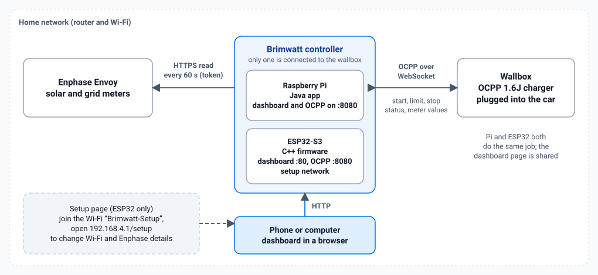

The Pi and the ESP32 do the same job and only one is connected to the wallbox at a time. The setup network exists only on the ESP32 (the Pi takes its settings from `/etc/solar-charger.env`).

## What happens at start-up

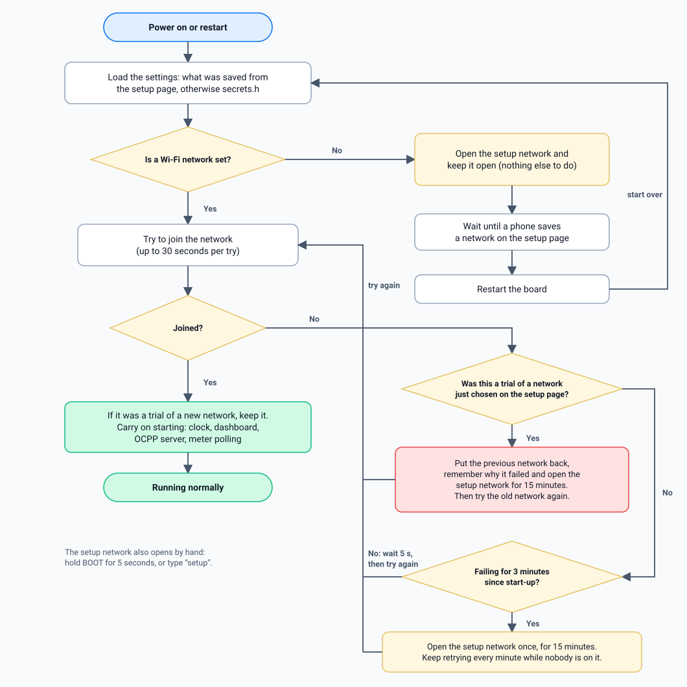

The web server starts **before** the Wi-Fi is up, so the setup page can be served when there is no Wi-Fi to join. Everything else (clock, dashboard, OCPP, meters) starts once the board is connected.

## A Wi-Fi change is a trial

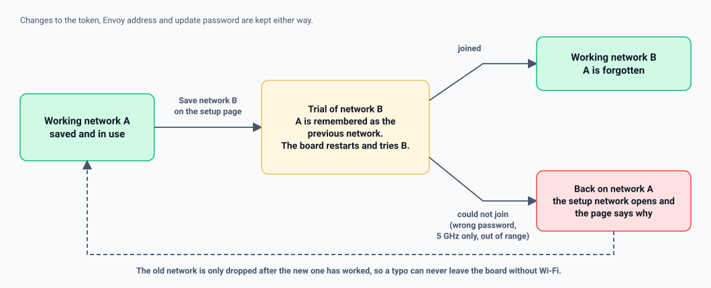

After a save with a different network (or a different password for the same one) the board keeps the previous network in reserve, restarts and tries the new one. If it joins, the new network is kept. If it cannot (wrong password, 5 GHz only, out of range) the previous network is put back and the setup network opens again with the reason on the page, for example `Could not join "X": wrong password. The previous Wi-Fi was put back.` Changes to the token, Envoy address and update password are kept either way. The error is shown once: a normal start clears it.

## Where each value comes from

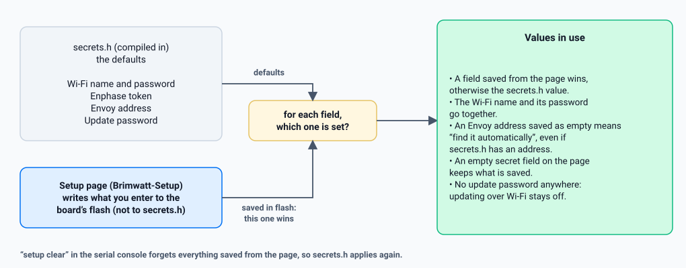

`secrets.h` still works as the set of defaults. The Wi-Fi name and its password go together. An Envoy address saved as empty (stored as `auto`) means "find it as `envoy.local`" even if `secrets.h` has an address. With no update password anywhere, updating over Wi-Fi is switched off rather than left open.

## Using it (iPhone)

1. Join the Wi-Fi **Brimwatt-Setup**, password `brimwatt`. If the page does not open by itself, open `http://192.168.4.1/setup` in Safari.
2. Tap your network in the list (strongest first; a name seen on several access points appears once). Type its password. Hidden networks cannot be listed, so use *My network is not listed*. **Scan again** looks again; the page may stall for a few seconds because the board scans on the radio the page uses.
3. Paste the **Enphase token**, check the **Envoy address** (empty finds it by itself) and set an **update password**. Leaving a secret field empty keeps what is saved; the page only ever says that one is saved.
4. **Save and restart.** Rejoin your usual Wi-Fi and open `http://brimwatt.local`.

## What the page looks like

<table>
<tr>
<td align="center">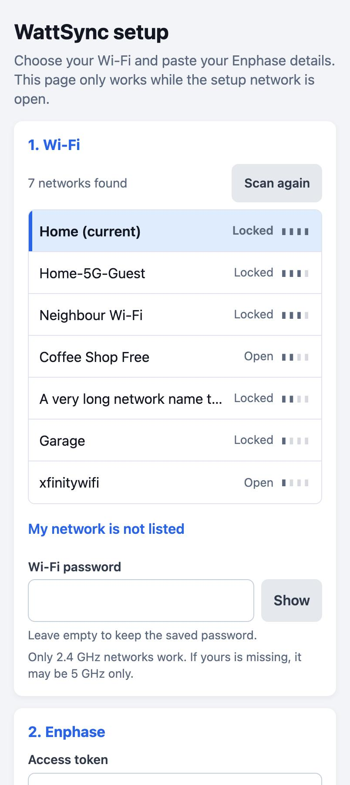<br><sub><b>1.</b> Networks found, strongest first. The current one is selected.</sub></td>
<td align="center">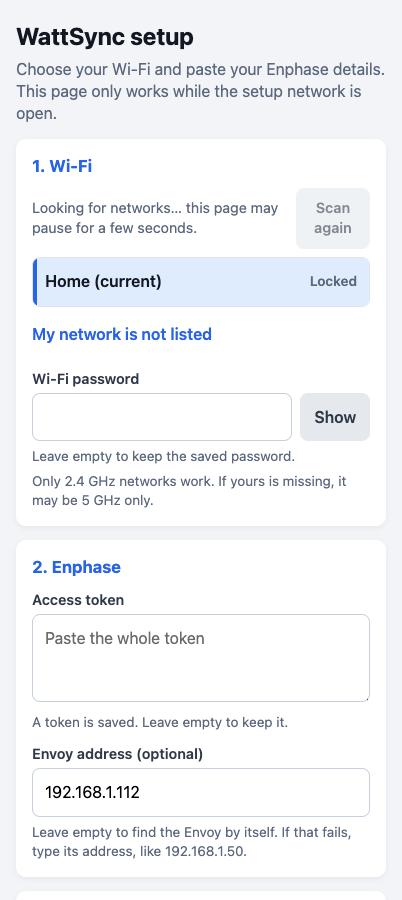<br><sub><b>2.</b> While scanning (Scan again). Only the saved network is listed.</sub></td>
<td align="center">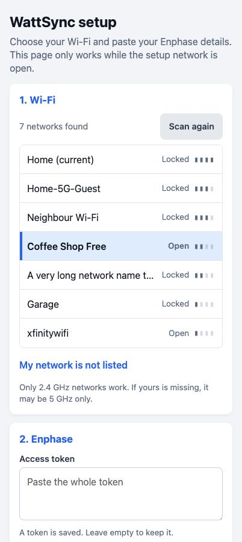<br><sub><b>3.</b> An open network is chosen, so no password is asked.</sub></td>
<td align="center">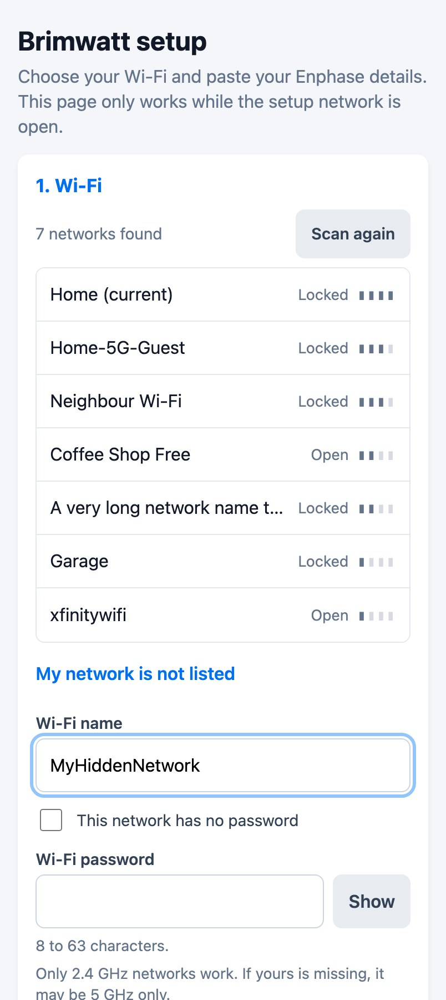<br><sub><b>4.</b> “My network is not listed”: type the name (for a hidden network).</sub></td>
</tr>
<tr>
<td align="center">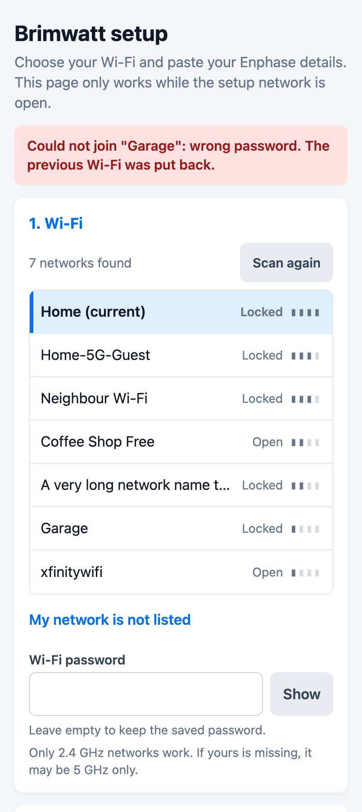<br><sub><b>5.</b> After a failed trial: why, and that the old Wi-Fi was put back.</sub></td>
<td align="center">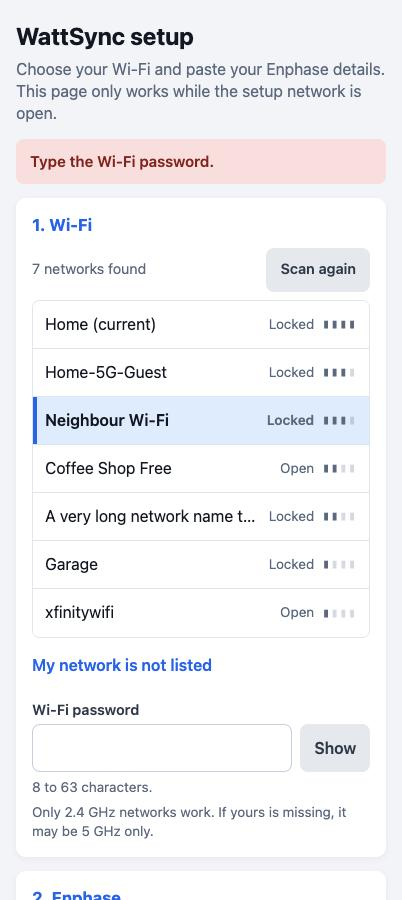<br><sub><b>6.</b> A refused form shows the reason at the top; nothing is saved.</sub></td>
<td align="center">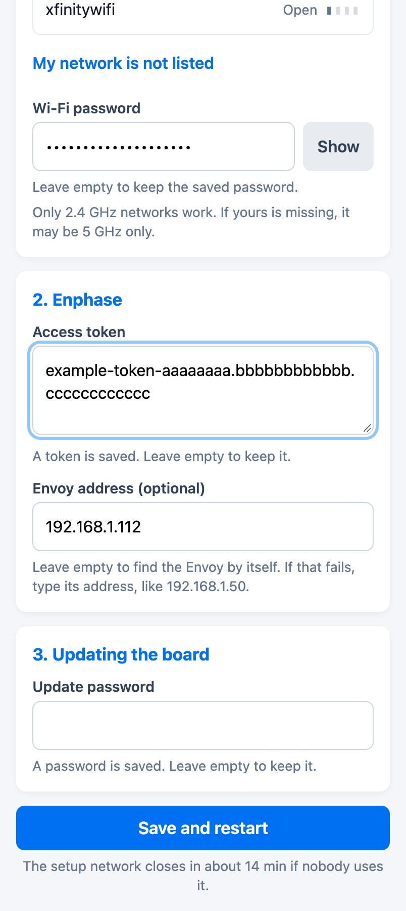<br><sub><b>7.</b> Token, Envoy address and update password. “Saved” hints keep existing values.</sub></td>
<td align="center">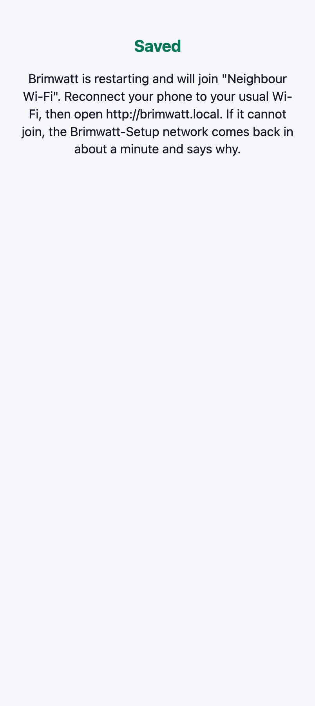<br><sub><b>8.</b> After saving: what happens next.</sub></td>
</tr>
</table>

The page is one file, `esp32/src/web/setup.html`, with 16 px inputs (so iOS does not zoom in), touch targets of at least 44 px, and no sideways scrolling from 320 to 1600 px wide.

## What the form accepts

| Field | Rule |
|---|---|
| Wi-Fi name | 1 to 32 characters, no control characters; stray line breaks from pasting are dropped. Empty keeps the saved network. |
| Wi-Fi password | 8 to 63 characters. Needed for a different network unless it has no password (the page sends `open=1` for networks listed as open or ticked in manual entry). Empty with the same network keeps the saved password. |
| Enphase token | Spaces, line breaks, surrounding quotes and a leading `Bearer ` are removed first. 20 to 4096 characters, only letters, digits and `- _ . ~ + / =`. Empty keeps the saved token. |
| Envoy address | Empty finds it automatically. Otherwise dotted decimal, four numbers 0 to 255, no leading zeros, not `0.0.0.0`. |
| Update password | 8 to 64 characters, no spaces or control characters. Empty keeps the saved one. |

The first problem found is reported, in plain words, and nothing is saved.

## Endpoints

All of them answer **403** while the setup network is closed (`Setup is off. Hold the BOOT button for 5 seconds to turn it on.`). Changing requests (`POST`) also need the `X-Brimwatt: 1` header, like the rest of the API. Secrets travel in the body of a POST, never in an address, and **no reply ever contains a secret**.

| Endpoint | Purpose |
|---|---|
| `GET /setup` | the page |
| `GET /api/setup/status` | saved Wi-Fi name, whether a token and update password are saved (yes/no only), the Envoy address, the last Wi-Fi error, seconds left |
| `GET /api/setup/networks` | `scanning` and the list (`ssid`, `rssi`, `secure`) |
| `POST /api/setup/scan` | look again |
| `POST /api/setup/save` | form fields `ssid`, `password`, `open`, `token`, `envoyIp`, `updatePassword` |

While the setup network is open, a phone joined to it that asks for `/` or any unknown address (the probes phones send, such as `/generate_204` and `/hotspot-detect.html`) is redirected to the setup page. Devices on the home network still get the dashboard.

## Where it lives in the code

| Piece | File |
|---|---|
| Rules: form validation, token cleaning, IPv4 check, scan list, the trial | `esp32/lib/solar_core/src/setup/SetupLogic.*` |
| The endpoints and the interface they need from the board | `esp32/lib/solar_core/src/setup/SetupApi.*` |
| Access point, DNS catch-all, scan, 15-minute limit, BOOT button, restart | `esp32/src/net/SetupPortal.*` |
| Saved values in flash | `esp32/src/platform/NvsCredentialStore.*` |
| Wi-Fi join with run-time name and password, and why it failed | `esp32/src/net/WifiConnection.*` |
| Token and Envoy address set at run time | `esp32/src/enphase/EnphaseClient.*` |
| Routes and the captive-portal redirect | `esp32/src/web/WebServerAdapter.*` |
| The page | `esp32/src/web/setup.html` (embedded via `platformio.ini`) |
| Start-up flow (`bringUpNetwork`) | `esp32/src/main.cpp` |
| Console commands `wifi`, `setup`, `setup clear` | `esp32/src/console/SerialConsole.*` |
| Timings and the BOOT pin | `esp32/src/config/DeviceConfig.h` |

## Tests

`esp32/test/test_setup` has host tests (no board needed): every form rule, token and address cleaning, saved values winning over defaults, the scan list, the trial kept or undone (including "no previous network"), the endpoints being refused while setup is closed or without the header, a save that starts a trial or not, and that the status reply never contains a secret.

```bash
CPLUS_INCLUDE_PATH=$(xcrun --show-sdk-path)/usr/include/c++/v1 esp32/.venv/bin/pio test -d esp32 -e native -f test_setup
```

**Checked on the computer only:** the logic, the endpoints, the page against a stand-in server, and that the firmware builds. **Confirmed on the board:** the setup network opens, an iPhone joins it and the page works. **Still to check on the board:** the trial and undo with a real wrong password, saving a real change, and setup with the router off at start-up. The list of checks is in section 4 of `esp32/README.md`.

## Safety and limits

- The setup network's password is the same on every board and is written in this repository, so while it is open anyone in Wi-Fi range who has read it could join and change the settings. The window is short (15 minutes, and only after a failure, a BOOT press or a console command), but it is real. Deriving it from the board's chip ID is the planned improvement.
- The saved values are in the flash's `net` area, which is not encrypted: someone holding the board can read them, exactly as they could read values compiled into the firmware.
- If the router's password changes while the board is **running**, nothing opens by itself: power-cycle the board (it opens after 3 minutes of failing) or hold BOOT.
- Only 2.4 GHz networks can be joined or listed. While the setup network is open the board answers a little slower, because the radio is shared with the home Wi-Fi.
- A failed trial leaves the setup network open for its time window, even if the old network came back, so the reason can be read on the phone.

## Rolling back

This feature was added on top of a baseline commit in git. See "Git and rollback" in `CLAUDE.md`: `git checkout before-setup-network` (a branch; the tag `snapshot-before-setup-network` marks the same commit) shows the code as it was before, and `git revert` of the setup-network commit removes it while keeping later work.
